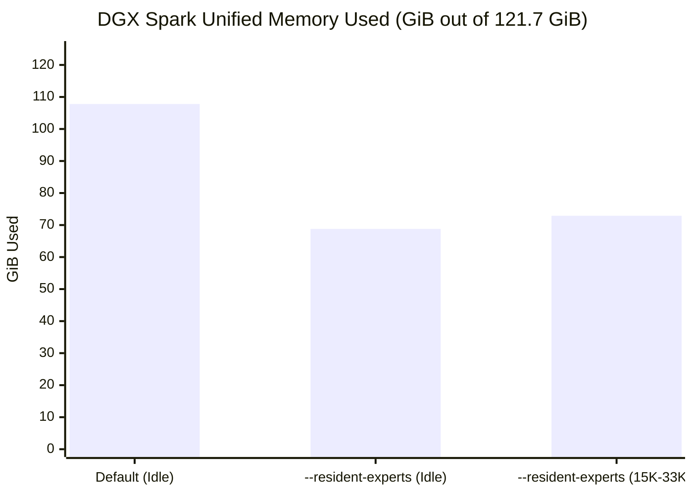
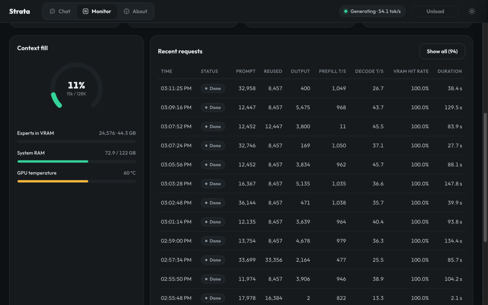

# edge0-sparkplug


Standalone Docker build and runtime configuration for running **Edge0-145B-NVFP4** (`edge0-strata` + `edge0-infer`) on an **NVIDIA DGX Spark** (GB10, ARM64, `sm_121`, 128 GiB unified LPDDR5x memory).

### TL;DR
- **145B MoE (6.6B active) locally on 128 GiB unified memory** — zero expert swapping (`100%` VRAM hit rate).
- **Up to `1,050 tok/s` prefill & `36–54 tok/s` decode** at `~38 W` / `60 °C` under sustained `12K–36K` context.
- **`--resident-experts` saves ~39 GiB RAM** (`107.8` → `68.8 GiB` idle), leaving `~49–53 GiB` free headroom.

## Why This Setup

- **Self-contained Docker build ([Dockerfile](Dockerfile)):** Multi-stage `nvcr.io/nvidia/cuda:13.0.1-devel-ubuntu24.04` → `13.0.1-runtime-ubuntu24.04` build targeting ARM64 (`-DSTRATA_FORCE_ARM64=ON`) and Blackwell GB10 (`-DCMAKE_CUDA_ARCHITECTURES=121`). Clones [`Edge0-AI/Edge0`](https://github.com/Edge0-AI/Edge0) at build time (pinned to `7b60076641ccd4adeec8b9a41874a24c477fec02`, overridable via `EDGE0_REF`) and unpacks the matching `llama.cpp` revision (`3cf03257f219afbe7334045ff7c6a06ac68c627d`).
- **Unified Memory Optimization (`--resident-experts` in [strata.json](strata.json)):** By default, `edge0-strata` allocates both a GPU expert cache and a duplicate pinned host-RAM arena, consuming **107.8 GiB** out of **121.7 GiB** usable unified memory on DGX Spark. Enabling `--resident-experts` makes GPU and host expert residency strictly disjoint, dropping memory usage to **68.8–69.2 GiB** (**~39 GiB saved**, leaving **~52.5 GiB** free for OS, KV cache, and other workloads) with no throughput penalty.
- **Full 256K Context + Speculative Decoding ([strata.json](strata.json)):** Configured at the model's full native **`262,144` (256K)** context (`--max-context 262144`, `--kv int8`, `--ple-io direct`) with MTP speculative decoding (`--spec 4 --spec-min-p 0.5`), using only **`71.4 GiB`** at idle (**`50.3 GiB`** free).
- **Multi-Dialect API + LAN Auth ([docker-compose.yml](docker-compose.yml)):** Exposes OpenAI (`/v1/chat/completions`, `/v1/responses`) and Anthropic (`/v1/messages`) endpoints on port `8000` using `network_mode: host`, `ipc: host`, `memlock: -1`, and `STRATA_API_KEY` authentication (`Authorization: Bearer ...` or `x-api-key: ...`).

---

## Unified Memory Savings (`--resident-experts`)



> Disabling the duplicate host-RAM expert arena frees **~39 GiB** at idle (`107.8` → `68.8 GiB`), leaving **~49–53 GiB** of headroom even under `15K–33K` active context.

---

## Observed Performance & Parameters (DGX Spark / NVIDIA GB10)

Measured over LAN against `Edge0-145B-NVFP4` (`edge0-strata` `0.1.55`, `--resident-experts` enabled) under sustained `12K–36K` agentic traffic:



| Parameter / Metric | Observed Value |
| --- | --- |
| **Unified Memory Footprint** | `68.8 GiB` idle (`128K`) · `71.4 GiB` idle (`256K`) · `72.9 / 122 GB` under `15K–33K` active context (`~49–50 GiB` free) |
| **Expert Cache Residency** | `24,576` experts cached (`44.3 GB`), **`100.0%` VRAM hit rate**, `0.0 MB/s` disk read |
| **Model Disk Size** | `~106 GiB` (`Edge0-145B-NVFP4`) |
| **Context Window** | **`262,144` (256K)** configured (`--max-context 262144`, `--kv int8`) |
| **Prefill Throughput (12K–36K ctx)** | **`962 – 1,050 tok/s`** (with `8,457` reused prefix tokens) · `~106–140 tok/s` on tiny ~77-tok prompts |
| **Decode Throughput** | **`35.7 – 54.1 tok/s`** (`54.1 tok/s` peak during answering; `35.7–45.7 tok/s` sustained over 3.8K–5.5K output turns) |
| **Time to First Token (TTFT)** | `~0.68–0.73 s` (short ~77-token prompt) |
| **Power & Thermals** | `~8.7 W` / `33–34 °C` idle · `~30–38 W` / `42–60 °C` sustained load (`96%` GPU, `7%` CPU) |
| **Concurrency** | `1` serving slot (`concurrency.serving: 1`) |
| **Thinking Mode** | Enabled by default (`thinking: true, thinking_default: true`) |
| **Structured Output** | `json_object`, `json_schema` (`prompt_and_validate`, `constrained_decoding: false`, `stream_buffered: true`) |
| **Vision** | Disabled (`vision.enabled: false`, text-only) |

> **Harness note:** Because `concurrency.serving` is `1`, concurrent requests return `rejected_busy`—configure evaluation or coding harnesses for sequential execution (`max_concurrency=1`), or adjust serving slots if your workload requires parallel requests.

---

## Quickstart

### 1. SSH into DGX Spark & Clone the Repo
```bash
ssh <user>@<dgx-spark-ip>
git clone https://github.com/netlooker/edge0-sparkplug.git
cd edge0-sparkplug
```

### 2. Configure Your API Key
Create a local `.env` file (ignored by git) with your `STRATA_API_KEY`—otherwise `docker-compose.yml` falls back to the `change-me` placeholder:
```bash
echo 'STRATA_API_KEY=your-secret-key' > .env
```

### 3. Download Model Weights & Build the Image (in Parallel)
Both the `~106 GiB` model download and the CUDA/C++ image compilation take a while, so you can run them side by side in two SSH sessions (or `tmux` panes).

**Terminal 1 — Download [`Edge0/Edge0-145B-NVFP4`](https://huggingface.co/Edge0/Edge0-145B-NVFP4):**
```bash
hf download Edge0/Edge0-145B-NVFP4 --local-dir ./models/Edge0-145B-NVFP4
```
`strata.json` expects `model-skeleton.gguf`, `ple-fp8.gguf`, `experts.bin`, `labels.bin`, `latent_dense_q8.bin`, `profile.bin`, `mtp/`, and `tokenizer/` inside `./models/Edge0-145B-NVFP4` (mounted to `/models/Edge0-145B-NVFP4`).

**Terminal 2 — Build the Docker image:**
```bash
cd ~/edge0-sparkplug
docker compose build
```
*(Optional: build against a different upstream commit or branch of `Edge0-AI/Edge0` with `docker compose build --build-arg EDGE0_REF=main`.)*

### 4. Start the Server
Once both the download and the image build finish:
```bash
docker compose up -d
docker compose logs -f
```

### 5. Web UI & Endpoint Verification

**Strata Web UI:**  
Open `http://<dgx-ip>:8000/` in a browser and paste your `STRATA_API_KEY` in the **About** section to authenticate API requests from the UI.

**Health & Status:**
```bash
curl -s -H "Authorization: Bearer your-secret-key" http://127.0.0.1:8000/v1/status | python3 -m json.tool
```

**OpenAI `/v1/chat/completions`:**
```bash
curl -s http://127.0.0.1:8000/v1/chat/completions \
  -H "Content-Type: application/json" \
  -H "Authorization: Bearer your-secret-key" \
  -d '{
    "model": "edge0_145b",
    "messages": [{"role": "user", "content": "Hello!"}],
    "max_tokens": 256,
    "temperature": 0.2
  }' | python3 -m json.tool
```

**Anthropic `/v1/messages`:**
```bash
curl -s http://127.0.0.1:8000/v1/messages \
  -H "Content-Type: application/json" \
  -H "x-api-key: your-secret-key" \
  -d '{
    "model": "edge0_145b",
    "max_tokens": 256,
    "messages": [{"role": "user", "content": "Hello!"}]
  }' | python3 -m json.tool
```

---

## Prerequisites

- **Hardware:** NVIDIA DGX Spark (GB10 / ARM64, 128 GiB unified memory)
- **Software:** Docker Engine + Docker Compose v2 + NVIDIA Container Toolkit (`nvidia-ctk`)
- **CLI:** Hugging Face CLI (`hf`) for downloading model weights
- **Disk Space:** `~125 GB` free (`~106 GiB` for `Edge0-145B-NVFP4` weights + Docker build layers)

---

## Connecting Coding Agents & SDKs

Point any OpenAI- or Anthropic-compatible client, SDK, or coding harness at your DGX Spark:

**OpenAI-compatible clients:**
```bash
export OPENAI_BASE_URL="http://<dgx-ip>:8000/v1"
export OPENAI_API_KEY="your-secret-key"
# model: edge0_145b
```

**Anthropic-compatible clients:**
```bash
export ANTHROPIC_BASE_URL="http://<dgx-ip>:8000"
export ANTHROPIC_API_KEY="your-secret-key"
# model: edge0_145b
```

---

## Credits

- Inference engine & server: [`Edge0-AI/Edge0`](https://github.com/Edge0-AI/Edge0) (`edge0-strata` + `edge0-infer`, Apache-2.0)
- Upstream Strata engine & Monitor UI: [`Niko1221/Strata`](https://github.com/Niko1221/Strata) (MIT)
- Model weights: [`Edge0/Edge0-145B-NVFP4`](https://huggingface.co/Edge0/Edge0-145B-NVFP4)

## License

This repository's Docker and configuration files are licensed under the [Apache License 2.0](LICENSE), matching [`Edge0-AI/Edge0`](https://github.com/Edge0-AI/Edge0). Model weights are governed by their own upstream license on Hugging Face.
